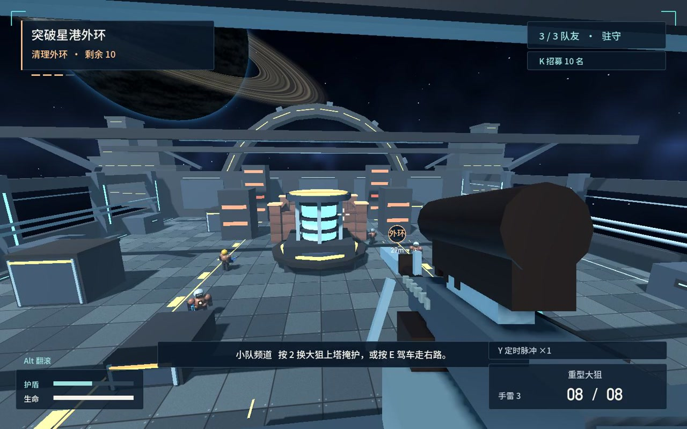

# 实机演示视频

录制日期：2026-11-22。当前开发预览 0.16.1，36 秒，1280×800，30 FPS，H.264 / AAC，约 7.1 MiB。画面直接来自 Godot 的 Movie Maker；镜头和操作由 `tools/record_promo.gd` 驱动。视频展示星港环境、战役第一人称射击、屋顶大狙、第三人称小队推进、创造模式双方士兵/机甲/炮台交战。音乐及音效来自实际游戏混音。没有使用生成视频替代游戏画面。

这是对现有内容的演示，未展示联网匹配或玩家驾驶机甲。录制流程使用 `--record-promo` 隔离生涯、设置和战役写入；不会消耗玩家日常装备。录制不等同于交互测试，也不能用离线录制速度当作真实帧率基准。

视频地址：https://github.com/user-attachments/assets/acdaef10-f910-4493-a4ac-1157dd91e5d5

[](https://github.com/user-attachments/assets/acdaef10-f910-4493-a4ac-1157dd91e5d5)

## 重录

在仓库根目录准备 `work/promo/`，使用 Godot 4.5 Standard（下面以 macOS 本地路径为例）：

```sh
mkdir -p work/promo
work/tools/Godot.app/Contents/MacOS/Godot \
  --path outputs/StarportSquad --resolution 1440x900 \
  --always-on-top --disable-vsync \
  --write-movie ../../work/promo/raw.avi --fixed-fps 30 \
  --script ../../tools/record_promo.gd -- --record-promo
```

保持渲染窗口可见。脚本等待渲染完成事件，避免音画长度不一致。Windows 可换成 Godot 控制台可执行文件，用相同参数从仓库根目录录制。Godot 及 FFmpeg 可执行文件不随代码提交。

## 转码

使用 FFmpeg 两遍编码，限制文件体积，适合 GitHub issue 附件：

```sh
ffmpeg -i work/promo/raw.avi -t 36 -vf scale=1280:800 \
  -c:v libx264 -preset medium -b:v 1700k \
  -pass 1 -passlogfile work/promo/encode -an -f null /dev/null
ffmpeg -i work/promo/raw.avi -t 36 -vf scale=1280:800 \
  -c:v libx264 -preset medium -b:v 1700k \
  -pass 2 -passlogfile work/promo/encode -pix_fmt yuv420p \
  -c:a aac -b:a 96k \
  -af 'afade=t=in:d=0.4,afade=t=out:st=34.5:d=1.5' \
  -movflags +faststart outputs/StarportSquad-gameplay-0.16.1.mp4
```

Windows 第一遍的 `/dev/null` 换成 `NUL`。转码后检查完整画面、音画时长、音轨及文件大小，再上传到 [视频素材 issue #1](https://github.com/Micjoyce/starport-squad/issues/1)，把 GitHub 返回的附件地址替换到 README。视频通过 issue 托管，Git 中仅保留录制脚本、说明和封面图。
